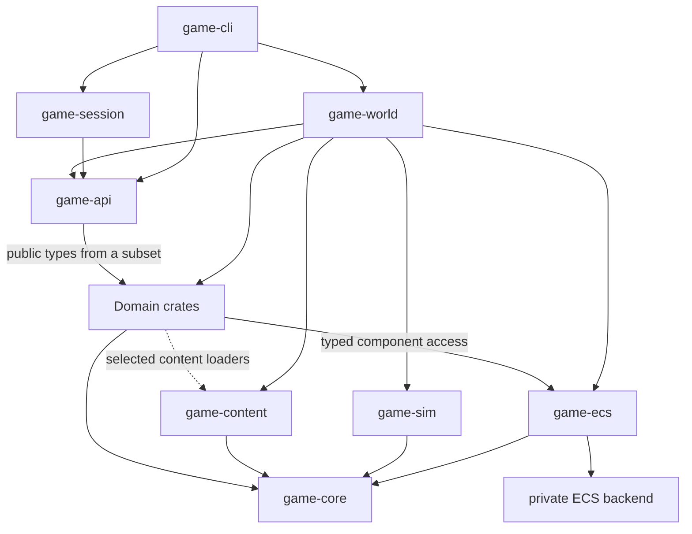

# Crate boundaries

Domain crates own game data and the systems that change it. `game-sim` supplies deterministic scheduling and parallel execution. `game-world` currently assembles the playable simulation, connects domain interfaces, and presents it through `game-api`; its remaining feature handlers are being moved into their owners.

## Dependency graph

An arrow means a production Cargo dependency, from consumer to provider. The domain node groups the 23 feature crates; its internal edges are listed below. Development dependencies are omitted.

The graph collapses `game-world`'s dependency on every domain crate and `game-api`'s dependencies on domain public types. `game-api` and `game-world` also depend directly on `game-core`. The API imports agreements, agriculture, armies, characters, conflict, ecology, health, invocation, lineage, missions, physiology, projects, property, realm, society, and transport.

Every domain crate depends on `game-core` for shared IDs, time, quantities, and errors. Their additional production dependencies are:

| Consumer | Providers | Shared interface |
| --- | --- | --- |
| `game-agriculture` | `game-ecs`; `game-content` (optional) | Typed component stores and joins; crop-definition loading |
| `game-armies` | `game-missions` | Objectives for autonomous leaders |
| `game-characters` | `game-logistics`; `game-genetics` (optional) | Material goals; opaque inheritable temperament loci |
| `game-conflict` | `game-cargo`, `game-skills` | Physical restraint stocks; combat practice effects |
| `game-environment` | `game-content` (optional) | Typed calendar and climate loading |
| `game-lifecycle` | `game-genetics` (optional) | Opaque inheritable reproductive characteristics |
| `game-lineage` | `game-logistics` | Care provision delivery requirements and receipts |
| `game-missions` | `game-agreements` | Agreement terms in mission objectives |
| `game-physiology` | `game-ecs`; `game-genetics` (optional) | Body components and numerical integration; opaque inheritable physical characteristics |
| `game-projects` | `game-agreements` | Project funding terms |
| `game-realm` | `game-agreements`, `game-missions` | Diplomatic terms and objectives |
| `game-society` | `game-agreements` | Obligations and disputes |
| `game-workshop` | `game-ecs`, `game-cargo`, `game-skills` | Optional job components; material inputs and outputs; work rates and craft practice effects |

`game-agreements`, `game-cargo`, `game-ecology`, `game-genetics`, `game-health`, `game-invocation`, `game-logistics`, `game-property`, `game-skills`, and `game-transport` have no other production dependencies. Existing optional integrations remain available; making every feature optional is no longer an architecture requirement.

## Components and systems

**Storage boundary:** `game-ecs` hides the chosen ECS engine. Feature data uses ordinary Rust types, stable game IDs, registered save schemas, and typed joins. Native entity handles, engine derives, and query internals remain in its private adapter. `game-sim` retains logical scheduling and per-simulation bounded execution.

**Ownership:** The host owns one component store. Each feature owns its component types, validation, rules, and prepared changes. Stable IDs join components on shared entities. Agriculture already uses this store; other features are being migrated. Query caches belong to running systems and rebuild after cloning or loading a save. Systems receive the component rows or typed facts they need; the composition applies material and other cross-feature effects through the receiving feature's interface.

**Engine independence:** Feature interfaces expose plain values, borrowed component rows, and typed prepared changes. They do not expose engine entity handles, derives, query types, or schedules. Replacing the engine changes the private `game-ecs` adapter; its callers keep the same interfaces. Systems order authoritative results by stable game IDs because engine iteration order is unspecified.

**Shared space:** Features share `game-core::AreaId` and `Location`, rather than defining separate maps. Fields refer to an area; soil attaches to the field entity; weather cells use the same area IDs. `Location::cell()` keeps a road segment in its departure cell until its scheduled arrival; carried entities use their resolved carrier location. Different spatial resolutions will use explicit mappings within this common model.

**Local inputs:** Environment owns weather cells keyed by `AreaId`. Agriculture joins `Field`, `Crop`, and `Soil` by `SiteId`, then looks up weather for the field's area. Crop growth consumes agriculture's `WeatherFacts`, supplied by the composition from environment observations. Agriculture has no dependency on environment's runtime or global climate state.

**Scheduling:** `game-sim` orders registered phases by explicit dependencies and clips an advance to the earliest predicted boundary. Features can use daily boundaries, work-completion deadlines, or other simulation intervals. The composition prepares a transaction from immutable inputs, then commits it before publishing the closing clock. Event-triggered behavior is currently connected by the composition; the engine does not provide a general event subscription bus.

**Parallel work:** The bounded executor evaluates independently keyed jobs from immutable inputs and merges results in logical-key order. Agriculture's growth batch is one example: each matched crop, soil, definition, and local weather input can be evaluated separately. Prepared changes retain the affected rows and validate their opening values before publication. Worker completion order does not determine game outcomes.

**Inherited traits:** Physiology, characters, and lifecycle implement genetics' `HeritableCharacteristic` interface to declare opaque loci. Genetics owns inheritance, crossover, and mutation. Trait owners interpret alleles and apply development or experience; genetics does not encode their trait meanings.

## Authored content

`game-content` reads human-editable TOML into feature-owned definitions. Features validate those definitions; saves retain their definitions and content stamps. Crops refer to stable definition IDs, so adding a crop using existing mechanics requires editing data rather than recompiling code. See [content/README.md](../content/README.md) for the available files.

The content migration is ongoing: goods and several other concrete game types still use code definitions. New mechanics belong in systems; new instances of an existing mechanic belong in content files.
