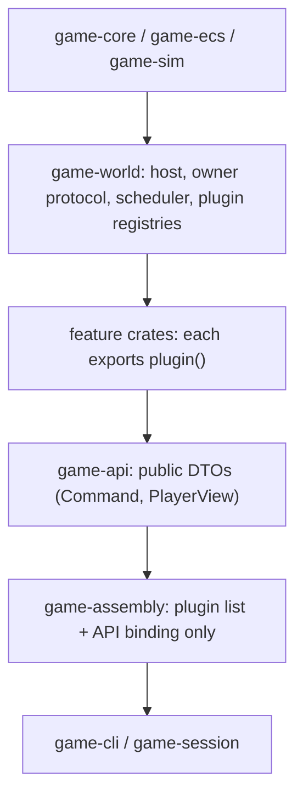

# Plan: actually modularize features out of `game-assembly`

## 1. Where things stand (measured 2026-10-14)

| Fact | Value |
| --- | --- |
| Workspace Rust LOC | ~370k across 35 crates |
| `game-assembly` | **73.7k LOC**, 40+ feature-named modules (`health.rs` 3.8k, `missions.rs` 3.4k, `physical.rs` 3.0k, `invocation.rs` 2.8k, …) |
| Kernels | Two complete paths: `KernelKind::Legacy` (default, runs **every** scenario) and `KernelKind::Native` (owner-protocol registry in `game-world`, only activated by the farming fixture in `agriculture.rs:54,64`) |
| Uncommitted work | 160 paths: ~100 modified files, ~60 untracked `native.rs` / `services.rs` / `systems.rs` modules in feature crates. Library targets compile. **Several test targets do not compile**, so most of this native code has never run |
| Machine | 8 cores, 7 GB RAM. A full workspace build is heavy, so cap parallel cargo jobs (see §6) |

**Root cause of the previous failure:** native owners were added *beside* the legacy path, not *instead of* it. Nothing could be deleted, so the assembly kept every legacy module and also gained `native.rs` (1.7k LOC), which hard-codes cross-feature activity priority, command dispatch and view composition.

**Edits already made by the planning agent (small test/compile fixes, uncommitted):**
- `game-lineage/src/systems.rs:277`: `source: Some(q.source)`
- `game-missions/src/native/tests.rs`: `game_characters::decisions::register_minds::<String>`
- `game-agreements/src/native/tests.rs` and `game-health/src/systems/tests.rs`: added `use game_sim::ClockWorld;`
- `game-genetics/src/inheritance_receiving.rs`: `game_world::owner_transaction::PreparedOwnerTransaction`
- `game-conflict/src/native_tests.rs`: added `use std::collections::BTreeSet;`

**Test targets still broken:** `game-invocation` (duplicate `mod tests` at `services.rs:1459`, private `Vitals`, missing `Default`s in `services_tests.rs`), `game-workshop/src/native_tests.rs` (missing dev-deps `game-conflict`, `game-characters`, `game-invocation`; stale signatures), `game-ecology/src/systems.rs:1419` (`GenericHost` not imported), `game-realm/src/native_tests.rs` (missing `game-sim` dev-dep; stale `.unwrap()`).

## 2. Should we start from scratch?

**Rewrite the composition from scratch. Keep the domain rules.**

- **Throw away:** the legacy kernel path. That covers `engine_adapter.rs`, `interval_transaction.rs`, `KernelKind`, legacy `Due`, every `impl …Port for …` adapter in the assembly, and every legacy fixture that builds state by hand. Do not migrate these. Delete them.
- **Keep:** the feature crates' rule code (combat math, genetics, crop growth, agreements, …) and the owner protocol already in `game-world` (`Registry`, `OwnerSystem`, `Request`, `Scheduler`, `DueQueue`, atomic commit). It already does what the user asked for: one standard transaction protocol. Don't redesign it. Only add the small registries in §3.2.
- **Rule for the implementer:** when legacy and native disagree, native wins. If native lacks a behavior, port the *rule* into the owning feature's native module, using the legacy code only as a reference. Never wrap legacy code in an adapter.

## 3. Target architecture

### 3.1 Layers

### 3.2 Small additions to `game-world` (one agent, done first, ~1 day)

1. **`Plugin` trait**: `fn register(&self, b: &mut Builder<S,E>) -> Result<(), Error>`. `Builder` wraps `Schema`, `Registry`, `Scheduler`, save validators and the registries below. Each feature exposes `pub fn plugin() -> impl Plugin` that registers its components, owners, requests, dues and schedule. This replaces the 700-line `register()` in `native.rs`.
2. **Canonical current action.** Use the existing `game_world::actions` component as the single "what is this person doing" row. The owner writes it, and the public `Activity` is a plain `From` conversion. This removes the hand-ordered `NativeKernel::activity()` chain.
3. **Command routes**: `Builder::route::<Req>(…)`. Because `game-api` depends on features, the `game_api::Command` → feature-request match stays in the app, one line per variant. That counts as binding (see §3.3).
4. **Input stops and successor detection** become `Request`s owned by Invocation, Conflict and Lineage. The app loops over them without interpreting them.
5. **Save validation hook** per plugin, so `persistence.rs` stays generic.

### 3.3 What `game-assembly` may contain when done (allowlist)

- `plugins.rs`: an ordered list of `game_x::plugin()` calls.
- `binding.rs`: `game_api::Command` → owner request (one arm per variant), and `PlayerView` built by calling each owner's read request (one line per field).
- `simulation.rs`: `Simulation::{new, load, save, submit, advance, observe}` over the generic host, plus command idempotency.
- `scenarios.rs`: only `match id { … => game_openings::build(…) / game_x::fixtures::… }` dispatch.
- No `impl *Port`, no loops over entities, no thresholds or scoring, no `if` that inspects feature state. **Budget: ≤ 2.5k LOC in `src/`.**

Enforce this with a new test, `game-assembly/tests/boundary.rs`, which fails when either check fails:
- (a) `src/` exceeds the LOC budget.
- (b) any file other than `plugins.rs`, `binding.rs` or `scenarios.rs` mentions `game_<feature>::`.

### 3.4 Cross-feature communication rules

- **Owner-defined requests.** The receiver defines the `Request` and the caller depends on the receiver's crate. For example, Agriculture calls `game_cargo::receiving::CargoConsume`.
- **When the edge would form a cycle**, the lower crate defines a fact request and the *upper feature's plugin* implements it. Never the app.
- **Requester-defined fact requests** such as `game_agriculture::systems::PersonExists` or `AreaExists` must be served by the requesting feature's own `peer_facts` module, not by the app. Prefer collapsing them into direct component reads when the crate dependency already exists.
- **Scenario construction lives with features.** Playable openings belong to `game-openings`. Each debug fixture moves to the feature it exercises (`game_x::fixtures`, behind a `fixtures` cargo feature) and is built *through plugins*, not hand-written rows.

## 4. Mapping assembly modules to owners

| Assembly module | Destination | Notes |
| --- | --- | --- |
| `agriculture.rs` (+tests) | `game-agriculture` | Already mostly native; delete legacy branches |
| `armies.rs` | `game-armies` | Finish native Army workflows |
| `authored.rs` | `game-content` / `game-openings` | Content loading and stamps |
| `combat.rs`, `combat/opening_preview.rs` | `game-conflict` | |
| `force.rs` | `game-conflict::force_native` | Yield, restrain, escape |
| `decisions.rs` | `game-characters` | Candidate selection already lives there |
| `development.rs` | `game-characters` (temperament/social) + `game-lifecycle` | |
| `population.rs` | `game-lifecycle` | Births, aging, death |
| `genetics.rs` | `game-genetics` (transmission) + `game-physiology` / `game-characters` (interpretation) | |
| `ecology.rs` | `game-ecology` | |
| `environment.rs` | `game-environment` | |
| `equipment.rs` | `game-workshop` (tool allocation) | |
| `quantities.rs` | `game-cargo::receiving::quantity_menu` | |
| `logistics.rs` | `game-logistics::native` | |
| `property.rs` (+atomic tests) | `game-property::services` | |
| `health.rs` | `game-health::systems` | Largest port; split by sub-flow |
| `physical.rs` | `game-physiology` (needs/eat/sleep) + `game-transport` (movement) | |
| `transport.rs`, `transport_motion.rs` | `game-transport` | |
| `institutions.rs`, `enforcement.rs` | `game-society` | |
| `social.rs` | `game-characters` + `game-society::personal_systems` | |
| `skills.rs` | `game-skills::systems` | |
| `projects.rs` | `game-projects::native` | Funding and procurement still missing |
| `agreements.rs` | `game-agreements::native` | Judgments, exchange, duty choice still missing |
| `missions.rs` | `game-missions::native` | Acquisition planning still missing |
| `invocation.rs` | `game-invocation::services` | Selection and views still missing |
| `lineage.rs`, `guardian_delivery.rs` | `game-lineage` | |
| `realm.rs` | `game-realm::native` | |
| `interruptions.rs` | `game-world::actions` (generic) + each owner's cancel handler | The `cancel_*` fns in `native.rs` move too |
| `maintenance.rs`, `interval_transaction.rs`, `engine_adapter.rs`, `host.rs`, `components.rs` | **delete** | Replaced by plugins and the scheduler |
| `compute`, `benchmark.rs` | review; keep only what benches need | |
| `native.rs` | split into `plugins.rs` / `binding.rs` | Feature logic goes to owners |
| `persistence.rs`, `commands.rs`, `lib.rs`, `scenarios.rs` | shrink to the §3.3 allowlist | |

`game-api` may keep depending on features for DTOs. Remove any logic in `native_domain.rs` that is not a type or a conversion.

## 5. Phases

### Phase 0: Baseline (1 agent, short)
1. Fix the remaining test-target compile errors from §1, then commit the WIP as one "native owners WIP" commit.
2. Write **`game-assembly/tests/playable_smoke.rs`**: for every id in `scenarios()`, construct it, advance N in-game days, save/load, and assert no error plus 1–2 key observations per scenario (e.g. combat fixture reaches `CombatInput`, life fixture produces a birth). This is the *only* broad test run between phases. Keep it under ~30 s.
3. Record which scenarios pass on Legacy today. That list is the regression target.

### Phase 1: Protocol additions (1 agent)
Implement §3.2 in `game-world` with focused unit tests in `game-world/tests`. Then convert `native.rs::register()` into calls of per-feature `plugin()` functions. Initially each feature's `plugin()` just wraps its existing `register_*` calls.

### Phase 2: Per-feature ownership (parallel, one agent per feature group)
Each agent owns **one crate group** and the matching assembly modules from §4. Per crate:
1. Make `game_x::plugin()` complete: components, owners, dues, schedule, routes, save validation.
2. Port any behavior that exists only in the legacy assembly module into the crate's native module. Use the legacy module as the reference for rules and the existing assembly tests as behavior references.
3. Move that module's assembly tests into the crate. Rewrite them as composed tests over a small `GenericHost` with only the needed plugins, and **do not import `game-assembly`**.
4. Add `fixtures` for that feature's debug scenario, built through plugins.
5. Validate with `cargo test -p game-x` **only**.
6. Commit per crate. Do *not* delete the assembly module yet; that happens in Phase 3 so agents don't collide in `game-assembly`.

Suggested groups, ordered by dependency (lower layers first; groups within a wave run concurrently):
- **Wave A:** environment+land+agriculture · cargo+logistics+property · transport+spatial · physiology+genetics+lifecycle · skills+workshop
- **Wave B:** characters (decisions, development, social) · health+ecology · conflict (combat+force+confinement)
- **Wave C:** agreements+projects · missions+armies · society (institutions, enforcement, personal) · lineage+invocation · realm

### Phase 3: Cutover and deletion (1 agent, sequential)
1. Switch every scenario to native and delete `KernelKind`, `engine_adapter`, legacy `Due`, and legacy `AssemblyState` fields. Move per-feature runtimes and due queues into plugin-owned slots so `AssemblyState` does not list features. If the registry slot API needs a typed resource map for this, add it in `game-world`.
2. Delete every assembly module marked for a destination in §4. Fix compile errors by calling the plugin or owner request, never by re-adding glue.
3. Run `playable_smoke`. Send each failure back to the owning feature agent as a focused bug.
4. Delete legacy kernels and `Ports` traits in feature crates that no longer have callers. Use `cargo +nightly udeps`, grep for `trait .*Ports?`, or temporarily make items `pub(crate)` to surface dead code.

### Phase 4: Final verification (1 agent)
- `boundary.rs` passes (LOC budget and import allowlist), and the existing dependency tests pass (features never import the assembly; `game-world` has no feature deps).
- Workspace checks: `cargo fmt --check`, `cargo clippy --workspace --all-targets -- -D warnings`, `cargo test --workspace`.
- Determinism checks pass: worker counts 1/4 and chunked vs. whole advance.
- Run benchmarks and update `game-assembly/README.md` numbers honestly.
- Rewrite `crates/README.md` (dependency table) and the per-crate READMEs, and update `MIGRATION.md`'s checkboxes and status section.

## 6. Rules for the implementing agents

- **Testing:** during Phases 1–2, test only the crate you changed (`-p`). No workspace tests or benchmarks until Phase 4, apart from the Phase 0 smoke test after each wave.
- **Resources:** run at most **3 concurrent** builder agents, each with `CARGO_BUILD_JOBS=2` and its own branch workspace and `CARGO_TARGET_DIR`, or you will run out of the 7 GB of RAM. Simple mechanical ports (moving tests, fixing imports) suit a lighter model; behavior ports (agreements, missions, health) need the stronger one.
- **Boundaries:** don't touch another group's crate. If you need a new request from another owner, ask the coordinator, who assigns it to that owner.
- **No new indirection layers:** don't create new integration crates unless one owns a single named interaction (MIGRATION.md §Assembly boundary review).
- **Commits:** commit per crate with a descriptive message.

## 7. Definition of done

1. `game-assembly/src` is ≤ 2.5k LOC and contains only the §3.3 allowlist, enforced by `tests/boundary.rs`.
2. There is one kernel and no legacy code path. `grep -r "Legacy\|impl .*Port for" crates/game-assembly` returns nothing.
3. Every feature has `plugin()`, composed tests that do not import the assembly, and its own fixture.
4. The playable smoke test passes for every scenario that passed in Phase 0, and save/load matches uninterrupted execution.
5. fmt, strict clippy and workspace tests pass, the READMEs reflect the real dependency graph, and the work is committed in reviewable increments.

## 8. Risks

- **Native gaps are larger than they look.** Most native code has never run. Mitigation: Phase 0 smoke plus Phase 2 crate tests surface gaps early, per owner.
- **Dependency cycles** while moving facts into features. Mitigation: the cycle rule in §3.4. Never solve a cycle by putting logic back in the app.
- **Feature runtimes in `AssemblyState`.** If plugin-owned slots can't hold state without the app naming the type, add a typed resource map to `GenericHost` in Phase 1. Do not keep a feature list in `AssemblyState`.
