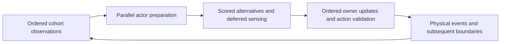

# Decision concurrency

The newer [attention and storage evaluation](ATTENTION.md) integrates the latest
main memory model, removes transaction/validation overhead, and separately tests
multi-rate attention and owner-authorized continuation.

The later [throughput evaluation](THROUGHPUT.md) measures coarser deliberation and
a demand-driven clock against the preceding production executable. The studies
below retain the earlier prototypes, their costs and their behavioral limitations.

The main simulation has exact speculative proposal preparation, an opt-in phased
proposal model, and a broader opt-in whole-actor preparation model. None changes the
default event-driven attention policy. The history driver also exposes resident
coordination and an optional active-worker executor. These experiments do not
establish a new fastest production executable.

## What a character sees

Ordinary characters observe and reconsider when scheduled reviews, completions,
arrivals, injuries or evidence notifications wake them. They do not all reconsider
at every global clock tick. Later reviews can see earlier same-time transactions.

It is possible to change that rule: gather observations, prepare decisions against
one read snapshot concurrently, then resolve actions in deterministic order.
Characters can incorporate the resulting information at their next decision
boundary. Shared supplies still need execution validation: two actors may plan
to consume the same item, but only the first successful action can consume it.
The choice tests cover this case without duplicating goods.

The provider-only pilot batches independent proposal providers. It refreshes the
due cohort's local and carried-store observations
before parallel preparation. Final selection, effectful providers and action
resolution remain live and ordered. Food inputs also remain live unless the
separate food-batching experiment below is enabled. Rare periodic-review entrants
outside the prepared cohort fall back to live providers. A full snapshot-based
actor model would also separate these remaining decision inputs and their effects.

## Exact work and remaining dependencies

With `--parallel-listeners true`, all independent providers prepare in one pool
submission across serial barriers. At each provider's original application
position the host validates its resource-read footprint. Only stale providers
retry. Attempted writes advance versions even if rolled back; missing resources,
nested reads, caught effects and panics are covered by tests. A 256-bit resource
type footprint can conservatively reject extra work on collisions, but cannot
accept a draft whose recorded input changed. Providers attempting effects retain
serial execution for that registry.

One seed-19 screen accepted 1,460,675 of 1,519,102 drafts, with 58,427 stale
retries and no effectful retries. High acceptance does not imply useful scaling:
there are many small tasks and joins, while observation, final choice, action
execution, scheduling and commits remain ordered. Shared cargo, relationships,
knowledge and global allocation/notice order prevent treating a character as an
independent mutable world. Regions reduce some conflicts but still exchange
people, goods, evidence and effects; they need explicit cross-region coordination.

The generic dependency executor lives in `game-drafting`. Proposal contracts live
in `game-offers`; phased preparation lives in `game-decision-frames`; assembly's
cohort/observation adapter lives in `game-autonomy-frames`. Character state and
scheduling remain character-owned; `game-character-clock` holds scheduling rules
without changing request or resource ownership. Feature owners retain callbacks and
requests; the existing host remains the only committer.

## Pyro as a storage reference

The inspected [Pyro source](https://github.com/MaikKlein/pyro/tree/5b32b724c4e4656160248164a251a62e29954c5f)
is a compact archetype ECS: each component combination has separate, aligned
columns; queries iterate linearly; structural operations are offered in bulk;
handles include generations. Its optional `threading` feature provides Rayon
parallel query iteration. The inspected HEAD is dated December 2019. It is a
storage/query library, not a transactional simulation scheduler.

This simulation already has dense rows, bulk operations and parallel passes in
`game-packed`, plus copy-on-write snapshots and undo journals. Logical sorted
iteration is deliberately distinct from physical row order. Replacing storage
would still require rollback, save migration, stable game identities and ordered
arbitration. Pyro's swap removal also changes physical iteration order; that order
must not become an implicit random or conflict-resolution order here.

The useful experiment is a joined column view for a measured hot pass, compared
against its existing keyed lookups and packed rows, including view construction,
copying, invalidation and commit costs. Independent preparation can then use
parallel column chunks and return owner-validated intents. Sharing mutable
inventory or relationship components still introduces conflicts. An isolated
position/velocity loop would not establish a history-throughput improvement.
The bulk-processing inspection led to a concrete memory batching fix and
row-journal/local-validation optimization; see the measured comparison in
[the attention evaluation](ATTENTION.md#exact-storage-comparison). Pyro itself has
been inspected, not yet benchmarked or adopted. Its source snapshot is
retained under `target/history/optimization/pyro-source/`.

## Avoided work and executor costs

Adaptive actor/provider chunks reuse one private transaction per chunk and retain
completed provider groups when a later provider fails. One-worker batches use one
chunk per actor. Saved cohort state is shared through `Arc`, avoiding a whole
cohort clone at each review. Action identities are captured once per actor. The
resident executor runs the committing loop inside the host pool, avoiding repeated
external handoffs. A new host after reload supplies its own executor.

An isolated gprofng run of exact four-worker resident execution attributed about
17% of sampled CPU to `syscall` and `sched_yield` combined. That motivated active
helpers, which service Rayon queues without parking while the coordinator runs.
An inclusive worker-wait frame also contains productive child work and must not
be reported as idle time. Active polling increases CPU occupancy even when it
does no useful simulation work.

The active-worker screen illustrates the tradeoff:

| Continuation | Ordinary 1 worker, wall / CPU s | Exact 4 active workers, wall / CPU s |
| --- | ---: | ---: |
| Seed 19, days 300–330 | 31.608 / 31.510 | 27.434 / 98.602 |
| 1,000 founders, days 1–2 | 50.445 / 50.326 | 41.640 / 148.284 |

This is a single-round screen, not a robust speedup claim. It spends about three
times the CPU for roughly 15–17% less wall time. Active execution stays off by
default. The same screen's one-minute phased model gains only about 3% from active
four-worker versus one-worker execution on seed 19. Saturating four cores is not
the same as parallelizing four cores' worth of useful computation.

## Decision interval changes behavior

One-minute frames coalesce review triggers, including injuries and action
completions, to the next boundary. Physical events keep their timestamps, but an
actor can wait idle after completing an action. This reduces review overhead and
also changes useful activity, reaction times, competition and identity allocation.
Even empty frame jobs consume scheduler identities, so divergence includes that
change. The model is opt-in and is not evidence of an exact optimizer upgrade.

In the first one-minute comparison, the 1,000-founder continuation produced 778
crafting batches instead of 1,554 and 251 social encounters instead of 464.
New deaths fell from 18 to 5; the starting population was 995, ending at 977 versus
990. Feeding events were similar, 1,622 versus 1,618. On the older seed-19 history,
crafting changed 30 to 29 and social encounters 379 to 184, with no new deaths in
either model. Fewer deaths alone does not establish a better model: reduced
interactions can remove conflict and beneficial activity together. The large
fixture is a young founding history, not a mature thousand-person civilization.

In the resident, one-round screen, ordinary / one-minute four-worker wall times
were 25.926 / 21.976 seconds on seed 19 and 43.888 / 13.356 seconds on the founding
case. These compare behaviorally different models within one frozen binary.
The large founding-case gain includes the substantial activity-rate change above.

Shorter intervals test information latency and idle delay separately from the
existence of a shared decision snapshot. `--decision-frame-millis 10000` enables
ten-second steps; the report below records that follow-up rather than assuming
one-minute behavior is acceptable.

The two-round ten-second resident comparison, before the joint-activity guard
described below, gave these medians:

| Continuation | Ordinary 1 worker s | Exact 4 workers s | Phased 1 worker s | Phased 4 workers s |
| --- | ---: | ---: | ---: | ---: |
| Seed 19, days 300–330 | 27.288 | 27.773 | 21.641 | 20.491 |
| 1,000 founders, days 1–2 | 44.044 | 49.916 | 13.694 | 12.174 |

All repeated complete artifacts agreed within each model, across workers and the
seed-19 midpoint reload. Ordinary results matched the preceding ordinary history.
However, founding-case crafting fell 1,554 to 598, encounters 464 to 152, and new
deaths 18 to 3. Older-history crafting was 30 versus 31 and encounters 379 versus
174, with no new deaths. Shorter steps did not restore the ordinary activity
distribution, and these outcomes cannot be attributed solely to idle delay.
Two rounds and two continuations are a screen, not a population-level model study.

## Joint-activity conflict

A focused regression reproduced a concrete model problem: after proposals were
prepared, an actor could become involved in an activity through another actor's
resolution. Its obsolete prepared choice could then cancel that newly started
activity. Live ordinary providers would have seen the new action when preparing
continuations. This is a stale-plan conflict, rather than a reason to require
same-step observation during parallel planning.

The current pilot records action identities with the cohort. Resolution defers a
turn if a new or replacement action has involved that actor since preparation.
The next boundary observes the activity normally. Merely finishing an old action
does not trigger the guard. A regression checks preservation of the new activity,
deferred decision timing, worker counts and a midstep reload. Default event-driven
behavior does not use this guard. The earlier phased timings/outcomes above
describe the unguarded pilot and must not be attributed to the corrected model.

The corrected ten-second pilot passed all five complete-history comparisons:
ordinary results match the frozen production control, and phased results match
across one/four workers and every tested midpoint reload. External continuation
also matches the unbroken world, ledger, people and concatenated journal when the
same interval is explicitly resupplied. The following is a **single-round screen**,
not repeated evidence of a production speedup. All columns use the same iteration
binary; controls with different compiler settings are excluded from this table.

| Continuation | Ordinary 1 worker s | Exact 4 workers s | Phased 1 worker s | Phased 4 workers s |
| --- | ---: | ---: | ---: | ---: |
| Opening, days 10–12 | 7.160 | 8.275 | 7.574 | 7.051 |
| Seed 11, days 300–330 | 2.926 | 4.203 | 3.945 | 2.945 |
| Seed 19, days 300–330 | 33.597 | 33.315 | 20.525 | 17.711 |
| Seed 37, days 300–330 | 16.297 | 15.695 | 16.966 | 13.883 |
| 1,000 founders, days 1–2 | 40.894 | 42.136 | 14.475 | 11.177 |

Exact four-worker execution establishes no large improvement here. The phased
four-worker run is about 1.90× faster on seed 19 and 3.66× on the founding case,
with little gain in the opening/seed-11 cases. Ambient variation is substantial:
ordinary seed-19 times across these studies range from about 24 to 34 seconds.
Do not treat a single small difference as a reliable gain.

The conflict guard fixes the reproduced invalid cancellation, but does not
restore ordinary activity rates. Corrected founding-case crafting is **595 versus
1,554** batches, encounters **152 versus 464**, attacks **252 versus 616**, and new
deaths **3 versus 18**. Feeding is 1,614 versus 1,622. Seed-19 crafting is 29 versus
30 and encounters 176 versus 379; seed-37 crafting is 22 versus 38 and encounters
180 versus 337. Neither older held-out history has new deaths. Opening crafting
instead increases 45 to 51. These are different histories, not a uniform removal
of harmless computation. Fewer conflicts and deaths accompany lost productive
and social opportunities; the screen does not establish whether this improves
long-term behavior. The model remains opt-in.

## Why a short step can have a large effect

The pilot enforces **at most one review per step**; it does not give every actor
a fresh decision opportunity every step. Due-cohort collection retains the
ordinary event-driven agenda. In the saved founding fixture, ordinary periodic
review is 12 hours. After choosing an untimed wait, `game-autonomy-policy::next`
places the actor on that coarse review grid unless another event wakes it.
Consequently a snapshot that omits a temporarily unavailable opportunity can
lead to a much longer idle spell than the ten-second frame interval. This is a
confirmed scheduling path, not yet a measured attribution of the crafting loss.

Snapshot planning also changes contention: actors can prepare plans for the same
supplies or partners before earlier resolutions claim them. Rejected choices
receive ordinary failure-risk scoring. The saved retry window is **48 hours**;
that down-ranks an option rather than forbidding it for the whole window. Thus
some resolution conflicts can influence later choices far beyond one step.
The failure audit does not show more failed choices overall: among 975 people
surviving both founding continuations, ordinary execution records 33,922 new
failed choices versus 9,042 in the phased model. This mechanism's contribution
to lost activity remains unisolated. See `concurrency-failure-audit.json` under
the optimization artifact directory.

The single-worker phased founding run is already 2.83× faster than ordinary
execution; four workers add a further 1.30×. Much of the measured improvement
therefore comes from changing work performed, before useful parallel scaling.
Together with changed scheduler identities and subsequent ID-keyed randomness,
these differences prevent attributing the aggregate outcome change solely to
delayed perception. A narrower comparison needs to separate snapshot visibility,
decision scheduling, conflict handling and identity allocation.

## Recovery and broader query preparation

`--frame-recovery true` enables two mitigations together, independently of the
frame interval. Both are opt-in; ordinary execution and the preceding frame model
retain their saved representation and tested histories.

- After a review leaves an actor without an action, schedule one follow-up at the
  next boundary. If that follow-up is still idle, resume the ordinary agenda.
  A later external cue can start another recovery. This prevents an immediate
  missed opportunity from automatically becoming a twelve-hour wait without
  polling every idle actor at every boundary.
- Before attempting a selected prepared proposal, rerun its original provider in
  a private read-only transaction. If it no longer offers that request, skip it
  without learning a personal failure. Real refusals still teach. Checks that
  cannot complete safely retain ordinary execution; continuing actions bypass
  this check. A stale proposal also permits another bounded recovery.

The follow-up wake is retained when the current review finishes. Focused tests
cover bounded scheduling, later external cues, midframe reload, stale supply
checks without effects, actual character failure memory, and genuine refusals.
These mitigations do not restore ordinary semantics: review coalescing, shared
proposal snapshots, action ordering and scheduler identity allocation still
differ. The bundled recovery flag does not isolate the two mitigations' individual
contributions.

`--frame-food true` separately prepares food alternatives across the cohort.
`game-decision-food` owns this adapter; provisioning retains the query and action
implementation. A separate auxiliary-input event keeps cached food inputs out of
executable choices. Auxiliary queries join the existing actor/provider work in
one pool submission, with individual auxiliary tasks so a costly food query does
not hold up an entire provider chunk. Counts and typed inputs survive reload.
Missing inputs fall back to the live query. Urgency, scoring and consumption
remain live and ordered.

Food batching changes input timing. A regression deliberately changes food
knowledge after preparation and verifies that the cached alternatives persist
until the next boundary. Thus artifact agreement on particular histories cannot
establish that this is an exact transformation for all worlds.

The one-day pilot used ten-second steps, resident coordination, one/four workers
and the same iteration binary throughout. New founding-case events were:

| Model | Crafting batches | Social encounters | Feeding | Deaths |
| --- | ---: | ---: | ---: | ---: |
| Ordinary | 1,554 | 464 | 1,622 | 18 |
| Frame | 595 | 152 | 1,614 | 3 |
| Frame with recovery | 1,720 | 505 | 1,610 | 11 |
| Frame with food inputs | 595 | 152 | 1,614 | 3 |
| Frame with recovery and food inputs | 1,720 | 505 | 1,610 | 11 |

Recovery skipped 1,443 stale proposals. It restores substantial productive and
social activity, but exceeds ordinary rates on these measures; this is not a
claim of calibrated behavioral equivalence or improved welfare. Food batching
preserved complete ledger, journal and people artifacts within each recovery
setting in this pilot. World artifacts differ because the policy and prepared
inputs are saved. Ordinary and unmodified frame artifacts match their respective
frozen controls, and all models agree across tested worker counts.

The full thirty-day seed-19 continuation also recovers social opportunities:
ordinary execution produces 379 new encounters, the preceding frame model 176,
and recovery 348. Crafting is 30, 29 and 31 respectively, with no new deaths.
Recovery and recovery-plus-food have identical ledger, journal and people
artifacts here as well. These comparisons do not remove scheduler-ID divergence
or establish equivalent future histories.

Restoring activity removes most of the founding-case apparent speedup. In that
single-round pilot, ordinary execution took 44.534 seconds. Recovery took 49.014
seconds with one worker and 41.825 with four; adding food batching gave 49.446
and 40.290 seconds. The extra 3.7% reduction from food batching at four workers
is too small for a reliable claim from this screen alone. The preceding model's
roughly 3.7× advantage must not be presented as available with recovered activity.

The completed full-horizon study used two rotating rounds, without concurrent
builds, tests or profiling. Median wall seconds within the same binary were:

| Continuation | Ordinary 1 | Recovery 1 | Recovery 4 | Recovery + food 1 | Recovery + food 4 |
| --- | ---: | ---: | ---: | ---: | ---: |
| Seed 19, days 300–330 | 28.825 | 38.695 | 38.559 | 40.242 | 36.834 |
| 1,000 founders, days 1–2 | 45.762 | 55.360 | 45.872 | 54.390 | 54.743 |

Recovery alone shows 1.21× one-to-four-worker scaling on the founding case and
almost none on seed 19. That does not establish an improvement over ordinary
execution: the founding median is essentially equal and the older continuation
is slower. Food batching gives 1.09× worker scaling on seed 19 but none on the
founding case. It is not a demonstrated general optimization.

Parallel timings varied substantially: founding recovery took 40.176 and 51.567
seconds with four workers; recovery-plus-food took 46.343 and 63.143. Even
ordinary founding execution varied from 43.362 to 48.162 seconds. Two rounds
cannot separate small implementation effects from this variation. Four-worker
recovery policies averaged roughly 1.5 effective cores under a four-CPU quota;
they also consumed more total CPU than their one-worker counterparts. Neither
recovery nor food batching is promoted to a production performance default.

All complete artifacts agree across repeated runs and worker counts within each
model. Ordinary and preceding-frame controls agree; seed-19 midpoint reloads
agree for ordinary, frame, recovery and recovery-plus-food. Recovery with and
without food batching has identical ledger, journal and people artifacts on both
full-horizon fixtures, while world state records different policy/input caches.

## What remains on the serial path

A separate instrumented founding run with recovery, food batching and four
workers took 37.013 seconds in history advance. Inclusive spans recorded 17.071
seconds in full character review, including 10.146 in refreshed considered
options and 5.758 in caregiving options. Food queries accumulated 3.447 seconds
across threads. Provider spans overlap these spans and each other; do not sum
them or interpret their sum as elapsed time. Instrumentation preserved all four
pilot artifacts and was excluded from accepted timing.

The current batch parallelizes only part of a decision. Caregiving assessment
still emits perception updates, while final scoring and action execution remain
ordered. Global resource ownership prevents independently mutating each actor
through the current transaction API. More threads therefore do not expose a
population-sized batch of complete decisions.

The next substantial architectural step is to separate sensing effects from
pure decision preparation, including caregiving and final scoring. Preparation
could then return typed intents against one snapshot for deterministic resolution.
Moving currently live inputs to that snapshot is another model change; read
validation and selective recomputation are the exact alternative, with a scaling
cost when inputs change. Further parallel commits require partitioned state and explicit
cross-region messages or conflict resolution, including stable identity
allocation. Those are additional changes, not implemented by these mitigations.
Dependency-driven wake subscriptions could also avoid both coarse idle stalls
and repeated negative queries; bounded recovery is only a limited substitute.
Unconditionally reviewing 1,000 actors every ten seconds would create 8.64
million actor reviews per simulated day, versus about 74,000 full reviews in
the instrumented recovery run. The useful goal is to make changed information
available at boundaries and wake dependent decisions, rather than repeatedly
rebuild unchanged choices just to fill a parallel batch.

For caregiving specifically, `game-signals::Notice` computes a perception and
immediately stores it in the observer's `Signals` row. The useful split is a pure
assessment plus an owner-applied perception update. Care preparation must also
return proposals and any invalid delivery-intention cleanup through their owners.
Keep the ordinary request as the composition of assessment and application so
its ordering remains available. This is broader than parallelizing the small
signal arithmetic alone: candidate enumeration, concern valuation and final
choice need to move with it to expose substantial work.

Exact speculation currently versions whole resource types. A perception update
for one observer can therefore invalidate another observer's read of `Signals`,
even when their rows are independent. Actor- or region-scoped read/write tracking
is the corresponding exact-path improvement. It needs explicit ownership and
cross-scope dependencies; replacing transactions with a lock around the existing
global maps would retain the same serial bottleneck. Existing provider-only
draft acceptance is already high, so this is enabling work for broader actor
speculation, not evidence of a large gain from removing today's stale retries.

## Whole-actor preparation

`--frame-decisions true` implements the next broader preparation path in the main
simulation. The due cohort still follows the existing event-driven agenda; it
does not poll every actor at every boundary. After ordinary cohort observations,
one pool submission prepares each actor's full bounded alternative list, including
caregiving assessment, food alternatives, reserve plans, continuation values,
trait weights and failure-risk scoring. First-choice arbitration and execution
remain ordered. `--frame-recovery true` remains an independent setting.



`game-decision-intents` contains the shared pure scorer and the actor batch
adapter. Ordinary reviews call the same scorer, retaining their live collection
and action execution. The existing character owner registers the adapter and
keeps all mind writes. `game-offers` supplies private scratch collection, deferred
typed requests and pure-provider provenance. Choice-owned frame storage retains
the prepared result without adding a resource or plugin to ordinary saves.

Caregiving no longer needs to perform world writes during preparation:
`game-signals::assess` computes the ordinary perception without recording it,
and care assessment defers an owner-applied update. Invalid delivery cleanup is
also deferred and checks that the intention still matches before removing it.
Effects apply in their captured order only when that actor resolves. An assessment
cannot overwrite newer personal learning: its owner recomputes if the prior
perception changed, and ignores obsolete-time or out-of-contact updates.

An actor newly involved in a joint activity defers the entire prepared turn,
including sensing. Changed food-plan state or failure memory instead causes live
fallback, preserving handling of intervening completions and new personal failure
evidence. Any undeferred effect, caught write attempt, panic or failed query
discards that actor's whole preparation. The ordinary live path then runs; partial
deferred effects never escape failed preparation. Hooked signal observation also
uses live fallback. Selected pure offers retain named-provider rechecks, so a
vanished opportunity does not become personal failure evidence.

This changes the preceding hybrid model: food inputs, caregiving assessments and
final scores now use the boundary snapshot, and provider effects are deferred
rather than interleaved with later providers. Current action validation still
prevents duplicate stock consumption. Worker/reload equality must hold within
this new model, while outcome comparisons assess the timing changes separately.
This implementation does not partition mutable state between regions or add
actor-scoped exact read tracking. Its measurements determine how much those
further changes are needed after widening read-only preparation.

Whole-actor tasks alone expose too little parallel work when only one or two
actors are due. With parallel listeners enabled, small cohorts therefore also
prepare independent providers within each actor using the same pool. Cohorts
with at least twice as many actors as workers retain coarser actor tasks to avoid
unnecessary nested drafts. Deferred effects and provider provenance merge in
ordinary callback order alongside offers; private effect buffers start empty to
avoid duplicating earlier updates. Strategy selection may depend on worker count,
but the snapshot policy and resulting history must not.

The first actor-only screen used one round and one simulated day per fixture.
On the founding case, recovery took 56.759 / 43.980 seconds with one/four workers;
whole-actor preparation took 58.643 / 40.637. Effective four-worker utilization
rose from 1.48 to 1.91 cores. Whole-actor new crafting, encounters, feeding and
deaths were 1,800 / 491 / 1,607 / 9, versus recovery's
1,720 / 505 / 1,610 / 11. Activity was retained, but the models differ.
The short older-history case instead slowed from recovery's 0.988 seconds with
four workers to 1.254, using only 1.02 cores. That motivated the adaptive nested
execution above. These single-run values are a screen, not a production upgrade.

A separate diagnostic founding run of adaptive nested preparation preserves all
four actor-only pilot artifacts. It records 82,405 successful preparations and no
effectful fallbacks. All 79,724 full reviews use prepared alternatives; no live
consideration refresh is recorded. Ordered full-review spans total 9.917 seconds,
versus 17.071 in the earlier recovery-plus-food profile. History advance totals
40.903 seconds in this diagnostic run. Actor preparation spans overlap across
actors and nested providers; their 58.741 accumulated seconds are not serial
elapsed time. The profiles cover different histories and review counts, so these
spans identify shifted work rather than establish an end-to-end speedup.

The completed adaptive study uses two rotating rounds, full continuation horizons
and the same iteration executable for every measured column. Median wall seconds:

| Continuation | Ordinary 1 | Recovery 1 | Recovery 4 | Whole decision 1 | Whole decision 4 |
| --- | ---: | ---: | ---: | ---: | ---: |
| Seed 19, days 300–330 | 27.974 | 38.065 | 34.947 | 41.697 | 38.388 |
| 1,000 founders, days 1–2 | 43.676 | 49.763 | 43.427 | 61.066 | 37.617 |

Whole-decision execution scales 1.62× on the founding case and 1.09× on seed 19.
Founding four-worker wall time is about 14% below ordinary execution and 13% below
recovery. This compares different histories: new crafting/encounters/feeding/deaths
are 1,800 / 491 / 1,607 / 9, versus ordinary's 1,554 / 464 / 1,622 / 18 and
recovery's 1,720 / 505 / 1,610 / 11. No welfare or causal survival conclusion follows
from these two continuations. Seed-19 whole-decision outcomes are 30 crafting
batches, 330 encounters, 401 feedings and no new deaths; ordinary produces
30 / 379 / 397 / 0 and recovery 31 / 348 / 413 / 0.

Four-worker whole decisions use median effective cores of 1.73 on seed 19 and 1.97
on the founding case, versus recovery's 1.56 and 1.50. They consume 66.419 and
73.810 CPU seconds respectively, compared with whole-decision one-worker CPU
times of 41.580 and 61.023. Higher occupancy includes execution overhead. More
threads do not establish four cores of useful work, and the older history remains
slower than ordinary execution. No default is changed or new fastest production
executable established.

Variation remains material: founding whole-decision one-worker runs take 57.116
and 65.016 seconds, while four-worker runs take 39.948 and 35.286. Their paired
scaling ranges from 1.43× to 1.84×. Both four-worker runs beat their corresponding
ordinary run, but two rounds are a screen rather than a precise gain estimate.

All repeated complete world, ledger, journal and people artifacts agree within
each model. Ordinary histories match the frozen production control, recovery
matches its preceding runtime, and adaptive whole decisions match the actor-only
prototype on both full horizons. Seed-19 midpoint reloads agree for all three
models; external continuation with explicit flags and a worker-count change also
agrees. Thus the adaptive task strategy preserves the tested actor-only histories,
while the broader snapshot policy remains a separate model choice.

A separate gprofng founding run also matches every measured artifact. Its
exclusive CPU table attributes 2.32% to `syscall` and 1.31% to `sched_yield`.
Allocation/free routines, string cloning, provenance-map insertion and repeated
trait/cache lookups remain visible costs. String cloning alone accumulates
4.62% inclusive CPU, overlapping allocation costs; these percentages must not be
added as independent bottlenecks. An unresolved libc frame accounts for 7.97%
exclusive CPU and is not assigned a guessed function name. This profile supports
reducing copying and repeated query inputs alongside future state partitioning;
it does not establish memory-bandwidth saturation or a regional commit speedup.

## Reproduction and evidence

Run all timings sequentially without concurrent builds, tests or simulations:

```sh
python3 tools/history/frames.py \
  --binary target/history/optimization/candidate-concurrency-guarded \
  --output target/history/new-concurrency-comparison \
  --cases opening heldout-19 scale --rounds 3 --verify-reload \
  --milliseconds 10000 --resident-executor
```

To reproduce the recovery comparison with both frozen controls:

```sh
python3 tools/history/frames.py \
  --binary target/history/optimization/candidate-frame-mitigation \
  --control-binary target/history/optimization/exact-factors-pgo/game-history \
  --control-frame-binary target/history/optimization/candidate-concurrency-guarded \
  --output target/history/new-frame-mitigation-comparison \
  --cases heldout-19 scale --rounds 2 --workers 1 4 \
  --models ordinary recovery recovery-food \
  --milliseconds 10000 --resident-executor --verify-reload --discard-verified
```

Add `frame food` to `--models` for the broader factorial screen, and
`--span-days 1` for the short pilot. Verified artifact pruning retains hashes,
outcomes and measurements; a failed comparison retains its artifacts.

The broader actor comparison uses a separately frozen runtime:

```sh
python3 tools/history/frames.py \
  --binary target/history/optimization/candidate-actor-intents-nested \
  --control-binary target/history/optimization/exact-factors-pgo/game-history \
  --control-recovery-binary target/history/optimization/candidate-frame-mitigation \
  --control-decisions-binary target/history/optimization/candidate-actor-intents \
  --output target/history/new-actor-intents-comparison \
  --cases heldout-19 scale --rounds 2 --workers 1 4 \
  --models ordinary recovery recovery-decisions \
  --milliseconds 10000 --resident-executor --verify-reload --discard-verified
```

The decision configurations enable parallel listeners, recording that setting per
run. The actor-only control leaves nested provider execution off and must agree
on complete artifacts. Model medians now match full configuration labels rather
than suffixes: older factorial pilot `food` medians could inadvertently include
`recovery-food` samples. Raw samples and the pilot values quoted above are
unaffected; the full recovery study did not include a standalone `food` group.

The driver rotates configuration order and measures full history continuations,
including export, with fresh-process wall/CPU/RSS measurements. It checks complete
world, ledger, journal and individual artifacts within each model. World object
field order is canonicalized; arrays and values are exact. Between-model outcomes
come from complete ledger totals, subtracting the saved prefix when counting new
events. Worker/reload equality is required separately from ordinary-policy
equivalence. Reports fingerprint inputs, executable and driver.

Artifacts under `target/history/optimization/`:

- `concurrency-screen/`: first per-provider preparation screen.
- `concurrency-hybrid-screen/`: adaptive scratch chunks and resident coordination.
- `concurrency-active-screen/`: active-helper screen above.
- `concurrency-10s-screen/`: two rotating rounds with ten-second frames.
- `concurrency-guard-screen/`: corrected joint-activity model, all five fixtures,
  ordinary-runtime control and worker/reload checks.
- `concurrency-guard-resume/comparison.json`: external two-segment continuation
  with the same explicit interval, compared with an unbroken continuation.
- `concurrency-{,hybrid-,active-}runtime.json` and matching source archives:
  executable/source provenance and checks. The first file is named
  `concurrency-runtime.json`.
- `concurrency-exact-profile.er` and `concurrency-exact-functions.txt`:
  separate diagnostic profile, excluded from timing.
- `frame-mitigation-pilot/comparison.json`: one-day ordinary/frame/recovery/food
  screen with one/four workers and both frozen controls.
- `frame-mitigation-study/comparison.json`: repeated full-horizon recovery/food
  comparison with worker and midpoint reload checks.
- `frame-mitigation-resume/comparison.json`: external continuation with recovery
  and food settings explicitly resupplied, including a worker-count change.
- `frame-mitigation-profile/summary.json`: separate instrumented founding run.
- `frame-mitigation-runtime.json` and `frame-mitigation-source.tar.gz`:
  executable/source provenance and verification results.
- `actor-intents-pilot/comparison.json`: first actor-only preparation screen,
  ordinary/frame/recovery controls and one/four-worker checks.
- `actor-intents-source.tar.gz` and `actor-intents-runtime.json`: frozen actor-only
  prototype used as the nested-execution behavior control.
- `actor-intents-nested-study/comparison.json`: repeated adaptive execution study
  with ordinary, recovery and actor-only controls and midpoint reload checks.
- `actor-intents-nested-profile/`: separate diagnostics, including complete-artifact
  verification against the actor-only screen before verified worlds were pruned.
- `actor-intents-nested-cpu.er`, `actor-intents-nested-functions.txt` and
  `actor-intents-nested-inclusive.txt`: separate CPU sampling, with complete
  artifact verification under `actor-intents-nested-cpu-run/`.
- `actor-intents-nested-resume/comparison.json`: unchanged explicit policy flags,
  parallel listeners, external continuation and a worker-count change.
- `actor-intents-nested-source.tar.gz` and `actor-intents-nested-runtime.json`:
  frozen source, executable provenance and checks for adaptive execution.

The guarded candidate is `candidate-concurrency-guarded`, with source archive
`concurrency-guard-source.tar.gz` and metadata `concurrency-guard-runtime.json`.
Its Rust/manifests fingerprint is
`0674296740e8a58e14d70513c6f09a4e655a83b975f6ed6e945f2a07682e34e9`
(686 files); executable SHA-256 is
`f711a7630a2af23c644e20cb8975ee78485859aa0b8ed9e28661913dc9e63a5d`.
The regression failed before the guard by cancelling the newly involved actor's
action, and passes with it. Verification includes 29 character tests, 63
kernel/choice/anticipation/drafting tests, eight history Rust tests, 41 history
Python tests, 12 performance-tool Python tests, strict Clippy and source budgets.

The recovery candidate is `candidate-frame-mitigation`. Its Rust/manifests
fingerprint is
`c98552fec87032dbdd919d510b9513e5868c3e86d894dfd5244998456d0108a3`
(689 files); executable SHA-256 is
`7b663d60016f3a741080db20c19b4d2ba5d66b6a8db4dd769b43b439a615cb85`.
Verification adds bounded-recovery, conflict-memory and typed auxiliary-input
reload tests: 32 character tests, 64 kernel/choice/anticipation/drafting tests,
eight history Rust tests, 43 history Python tests, strict Clippy and source
budgets passed. The separate external continuation and worker/reload comparisons
test deterministic replay within each model, not ordinary-policy equivalence.

The actor-only candidate `candidate-actor-intents` has Rust/manifests fingerprint
`d93c6cf460d3dded1e20427502ef3e148fcce04d64fc8a26117d748d2a7c37dc`
and executable SHA-256
`fa3a5fb1ea15e75dab90672a43ac273b4168b143a6fdc71e4ed43100e02ee31d`.
The adaptive candidate `candidate-actor-intents-nested` has fingerprint
`a3b32e7b934a75858b9eb9d2053776081b27ebb84fc405fe844ec1874dfc8675`
and executable SHA-256
`2e79fcf20444e7bc5da82fc8500abb7697e139b20bf82187bf1ad41de4466135`.
Both source archives contain 695 Rust/manifest files. The adaptive code passes
164 Rust tests, 44 history Python tests, strict Clippy and architecture budgets.
Focused regressions cover shared stock, deferred sensing without executable
offers, failed-preparation rollback, newer personal learning, joint activities,
worker counts and saved typed inputs after reload.

The concurrency candidates use the iteration `simulation` profile: O3,
16 codegen units, no LTO or PGO. Do not compare their raw speed with the old
`exact-factors-pgo/game-history` as though compiler settings were equal. That old
production executable remains untouched. Its ordinary histories match the tested
new ordinary runs; all pre-guard one-minute frame histories also agree across the
three executor versions, worker counts and tested midpoint reloads. These bounded
replays are evidence for the tested continuations, not a proof for every world.
